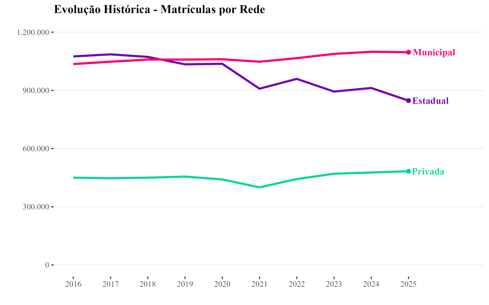
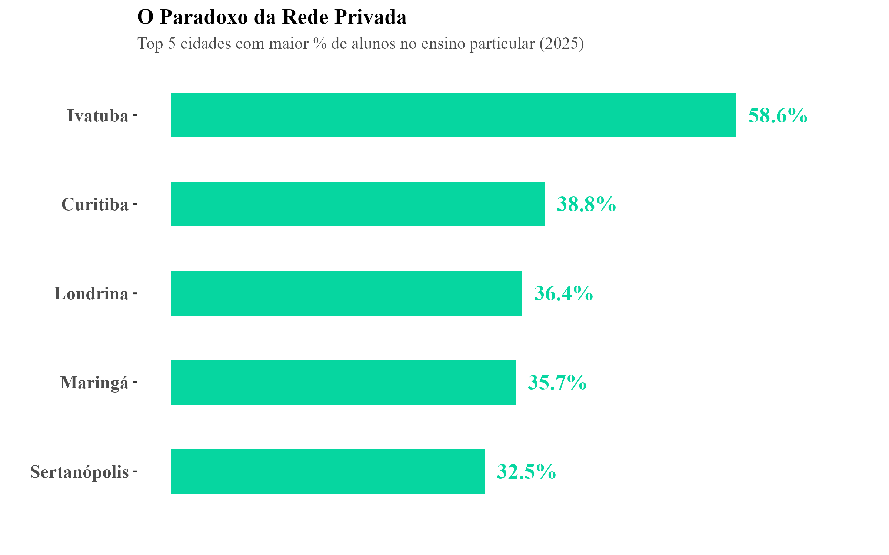
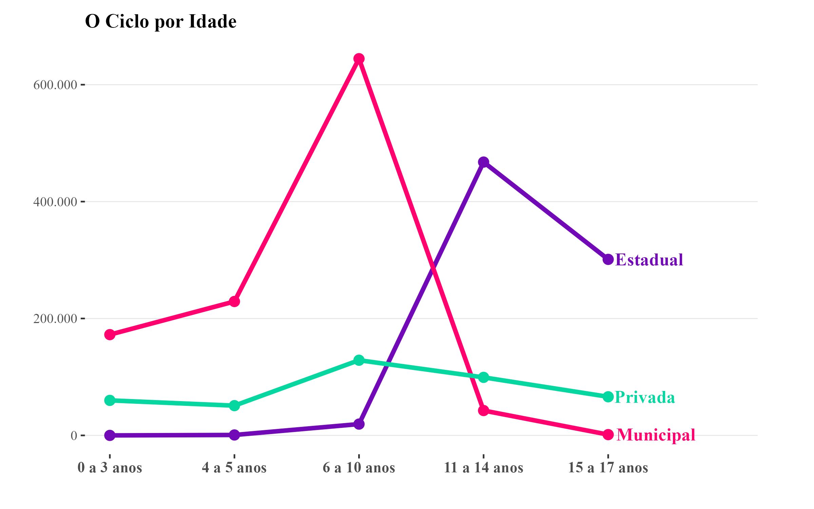
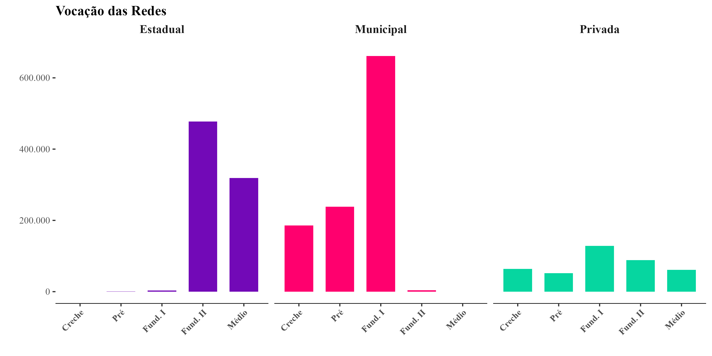

# O Funil da Educação Básica no Paraná 🎓📊

Este repositório contém os scripts e a análise visual desenvolvidos para o projeto da disciplina de **CE303 - Visualização de Dados Aplicada** (UFPR). O objetivo é explorar a dinâmica demográfica e a transição de matrículas entre as redes de ensino no estado do Paraná ao longo da última década (2016-2025).

## 🎯 Objetivo do Projeto
Construir uma narrativa visual impactante em um único painel (formato A4) que evidencie os gargalos e as mudanças estruturais no fluxo de alunos. A análise foca em entender como a estrutura educacional absorve os estudantes ao longo do seu percurso, evidenciando o "funil" demográfico e a transição de responsabilidades entre as instituições de ensino.

## 📖 A História dos Dados
O conjunto de dados apresenta um panorama detalhado da Educação Básica, mapeando o volume de matrículas de acordo com a **etapa de ensino** (da Creche ao Ensino Médio) e a **idade escolar** dos alunos em cada rede responsável. 

> **Nota Metodológica:** A rede Federal não foi incluída na análise visual final por possuir um volume de matrículas muito reduzido comparativamente às redes Estadual, Municipal e Privada. Sua inclusão comprometeria a escala e a clareza da visualização dos grandes fluxos.

## 📊 As Visualizações
O dashboard foi estruturado para contar a história dos dados através de quatro gráficos complementares:

## 📊 As Visualizações
O dashboard foi estruturado para contar a história dos dados através de quatro gráficos complementares:

1. **Evolução Histórica Geral:** Um gráfico de linhas temporais que demonstra a trajetória do volume total de matrículas entre 2016 e 2025. Permite identificar tendências de estabilidade, crescimento ou queda na captação de alunos por cada rede.

  

2. **O Paradoxo da Rede Privada:** Um gráfico de barras horizontais focado no ano de 2025. Subverte o senso comum ao elencar os 5 municípios com a maior percentagem de matrículas na rede particular (liderado por Ivatuba, com mais de 58%), demonstrando que o ensino privado tem forte representatividade também fora das grandes capitais.

  

3. **O Ciclo por Idade:** Um gráfico de linhas cruzadas que mapeia a quantidade de alunos por idade, respondendo visualmente à questão: *"Quem ensina em cada idade?"*. Evidencia a dominância da rede Municipal na infância e a brusca transição (o cruzamento das linhas) para a rede Estadual na adolescência (11 a 17 anos).

  

4. **Vocação das Redes:** Utiliza a técnica de *Small Multiples* para decompor as matrículas desde a Creche até o Ensino Médio. Separar as redes lado a lado em gráficos de barras permite ao olho humano comparar instantaneamente a atuação e o foco principal de cada instituição.

  

## ✒️ Princípios de Excelência Gráfica (Edward Tufte)
Toda a construção gráfica é rigorosamente baseada nos Princípios de Excelência Gráfica de Edward Tufte. Para atingir uma elevada taxa de *Data-Ink* (proporção tinta-dado), o painel foi construído utilizando o `theme_tufte`:
* **Eliminação de ruídos visuais (*chartjunk*):** Remoção de caixas de fundo e linhas de grade espessas.
* **Limpeza de eixos redundantes:** Omissão de palavras óbvias como 'Ano' e 'Faixa Etária' quando a escala visualizada já a torna evidente.
* **Rotulagem Direta (*Direct Labeling*):** As legendas tradicionais foram integralmente substituídas por rótulos posicionados diretamente no final das respectivas linhas ou barras, minimizando o movimento ocular e o esforço cognitivo exigido na interpretação.

## 🗂️ Os Dados e Fonte
A base original compreende dados reais com mais de 15.000 observações granulares extraídas dos **Microdados do Censo Escolar** disponibilizados pelo INEP.
* 🔗 [Resultados do Censo Escolar - INEP](https://www.gov.br/inep/pt-br/areas-de-atuacao/pesquisas-estatisticas-e-indicadores/censo-escolar/resultados)

## 🛠️ Tecnologias Utilizadas
* **Linguagem:** R
* **Ambiente:** RStudio
* **Pacotes Principais:** `ggplot2`, `dplyr`, `tidyr`, `ggthemes` e `patchwork`

---
**Autor:** Julio César Souza Freitas  
*Avaliação 1 (AV1) - Prof. Dr. Anderson Ara*
